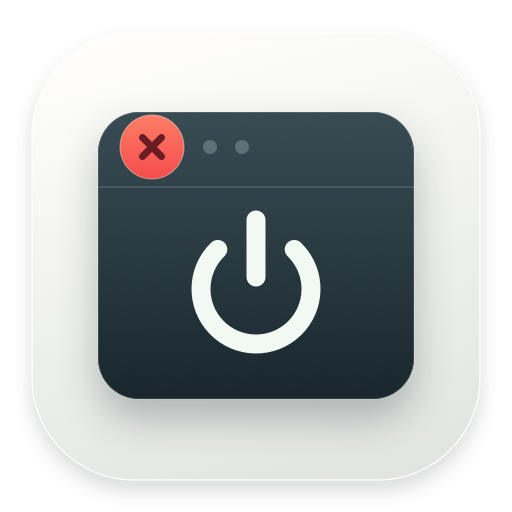

  

<h1 align="center">CallQuits</h1>

  <strong>Close the last window. Quit the app.</strong> 
  A small, native macOS menu bar app that gives the red close button a little more purpose.

  
  
  
  

  <a href="https://github.com/Mxlted/CallQuits/releases/latest"><strong>Download for Mac ↓</strong></a>
  &nbsp; · &nbsp;
  <a href="#get-started">Get started</a>
  &nbsp; · &nbsp;
  <a href="https://github.com/Mxlted/CallQuits/releases">Release notes</a>
  &nbsp; · &nbsp;
  <a href="https://github.com/Mxlted/CallQuits/issues">Report an issue</a>

---

On macOS, closing a window often leaves the app running. CallQuits lives in your menu bar and asks an app to quit after you click the red button on its last window. The app still handles its own close and save prompts.

## Why CallQuits?

- **Less left running.** Quit an app after its last window closes, or choose the optional any-window mode.
- **Your exceptions.** Keep apps running when you want them to. Common apps such as Music, Messages, and Terminal are excluded by default; you can [edit the list](docs/HELP.md#an-app-stays-open).
- **Easy to control.** Pause from the menu bar, adjust settings, and optionally start at login.
- **Local and private.** No accounts, telemetry, network requests, or third-party runtime dependencies.

## Get started

**Requires macOS 14 or later.** The current download is for **Apple silicon (M-series Macs)**. Intel users can try a [source build](docs/DEVELOPMENT.md); Intel builds have not yet been tested.

> [!IMPORTANT]
> **Early release:** v0.1.0 is ad hoc signed and **not notarized by Apple**. macOS may block its first launch. See [first-launch help](docs/HELP.md#macos-blocks-the-app). Compatibility testing across apps and macOS versions is still in progress.

1. **[Download CallQuits](https://github.com/Mxlted/CallQuits/releases/latest)** — choose the `CallQuits-0.1.0-macos-arm64.zip` file under **Assets** and open it.
2. **Move CallQuits.app to Applications**, then open it.
3. **Allow Accessibility access** in System Settings → Privacy & Security → Accessibility. Enable CallQuits, then reopen it if the permission status has not updated.
4. **Look for the × in a circle in your menu bar.** Open its settings to see CallQuits' status, choose your exceptions, or enable launch at login.

Accessibility lets CallQuits identify the close button and check an app's windows. It does not record keystrokes or document contents, and it does not request Screen Recording or Full Disk Access.

[Verify your download](docs/HELP.md#verify-your-download) · [Troubleshooting](docs/HELP.md)

## What happens when I close a window?

| What you do | What CallQuits does |
| --- | --- |
| Click the red button on the last window | Lets it close, then requests a normal quit once the window is confirmed gone. |
| Close one of several windows | Keeps the app running by default. Minimized windows and windows on other Spaces count too. |
| Cancel a close, encounter a save dialog, or open a replacement window | Cancels the pending automatic quit. |
| Press ⌘W, use a menu, or hold Option, Command, or Control while clicking | Leaves the app's usual behavior alone. |
| Close an excluded app | Leaves its usual behavior alone. Finder, system processes, and CallQuits are always protected. |

**Need force quit?** You can enable Shift-click force quit in settings. It is off by default, requires accepting an unsaved-work warning, and still respects exclusions. It can discard unsaved work in every window. A normal close never escalates to force quit.

## Questions

<strong>Why did an app stay open?</strong>

It may be excluded, have another window open, or be showing a save dialog. Some apps do not expose the window information CallQuits needs, and very fast clicks can be missed. CallQuits skips an automatic quit when it cannot verify the click or window state. Check **Settings → Activity** and the [troubleshooting guide](docs/HELP.md#an-app-stays-open).

<strong>Will it keep asking to quit after I dismiss a save dialog?</strong>

No. A save dialog cancels that automatic quit attempt, even if you later choose Save or Don't Save. CallQuits waits for a new close-button click.

<strong>Can I choose which apps it affects?</strong>

Yes. Open **Settings → Exceptions** from the menu bar. Add apps you want to keep running, or remove an optional default exception. Finder, system processes, and CallQuits remain protected.

<strong>Does it update itself?</strong>

No. New versions are available on the [Releases page](https://github.com/Mxlted/CallQuits/releases). See [update instructions](docs/HELP.md#update-callquits), including what to do if Accessibility access stops working after replacing the app.

## Help and development

Found a problem? [Open an issue](https://github.com/Mxlted/CallQuits/issues/new/choose) with your macOS version, the affected app, and what happened.

| Guide | What's inside |
| --- | --- |
| [Help](docs/HELP.md) | First launch, permissions, updates, and download verification |
| [Development](docs/DEVELOPMENT.md) | Build from source, Xcode, tests, and icon artwork |
| [How it works](docs/ARCHITECTURE.md) | Click verification, quit decisions, and safety boundaries |
| [Testing](docs/TESTING.md) | Automated coverage, recorded live results, and checks still needed |
| [Contributing](CONTRIBUTING.md) | Bug reports and development guidelines |

Free and open source under the [MIT license](LICENSE).
